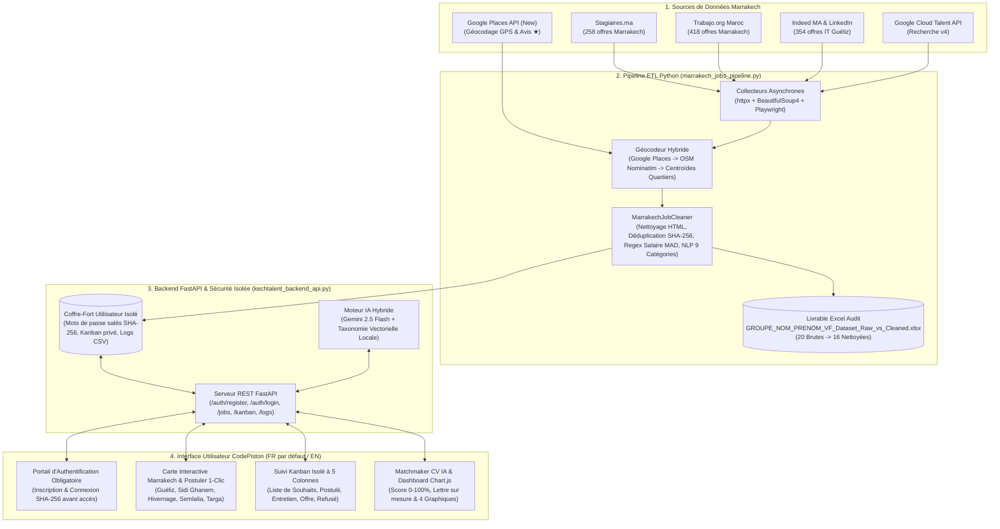

# CodePiston Marrakech — Plateforme Full-Stack Stages & Emplois (Livrable `GROUPE_NOM_PRENOM_VF`)

**CodePiston** est une plateforme web complète permettant de **rechercher, collecter, analyser, visualiser, postuler et suivre** les opportunités d'emploi et de stage à **Marrakech (Marrakech-Safi, 40000)**.

## 1. Architecture Globale de la Solution (VS Code Mermaid & Draw.io)



## 2. Étapes d'Installation, de Configuration et d'Exécution

### Prérequis
- Python 3.11+
- Navigateur Web moderne (Chrome, Edge, Firefox, Safari)
- Docker & Docker Compose (optionnel pour conteneurisation)

### Étape 1 : Configuration des Variables d'Environnement (`.env`)
```bash
cp .env.example .env
export GOOGLE_MAPS_API_KEY="VOTRE_CLE_GOOGLE_MAPS_ICI"
export GEMINI_API_KEY="VOTRE_CLE_GEMINI_ICI"
```

### Étape 2 : Exécution du Pipeline de Collecte et Nettoyage Python (Phase 1)
```bash
pip install -r backend/requirements.txt
python3 backend/marrakech_jobs_pipeline.py
```

### Étape 3 : Lancement du Serveur Backend FastAPI (Phase 2 & 4)
```bash
uvicorn backend.main:app --reload --port 8000
# Documentation interactive Swagger disponible sur : http://127.0.0.1:8000/docs
```

### Étape 4 : Lancement de l'Interface Frontend CodePiston (Phase 3)
Ouvrez `frontend/index.html` dans votre navigateur ou lancez `docker compose up --build` pour accéder à l'application sur `http://localhost:3000`.
